# TransitIQ schema diagrams

Open the markdown preview to render the pictures. Column lists stay in `database-schema.md`.

## The whole product

A company is a fleet. People, trucks, drivers, and shippers belong to that company. A trip ties one order, one truck, and one driver together. Roads are shared and sit outside the company. A trip meets the road when a driver reports an incident.

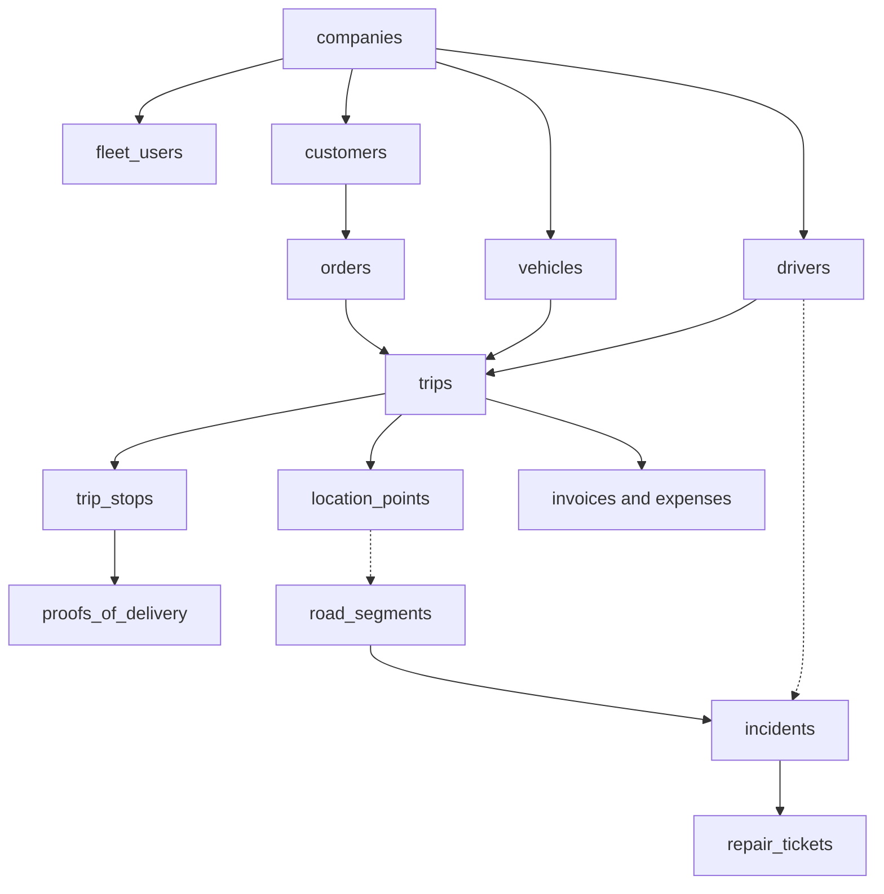

Solid arrows are ownership. Dotted arrows are where the fleet touches the road.

## 1. Company, people, access

The owner is a `fleet_users` row with the owner role. There is no separate owner table.

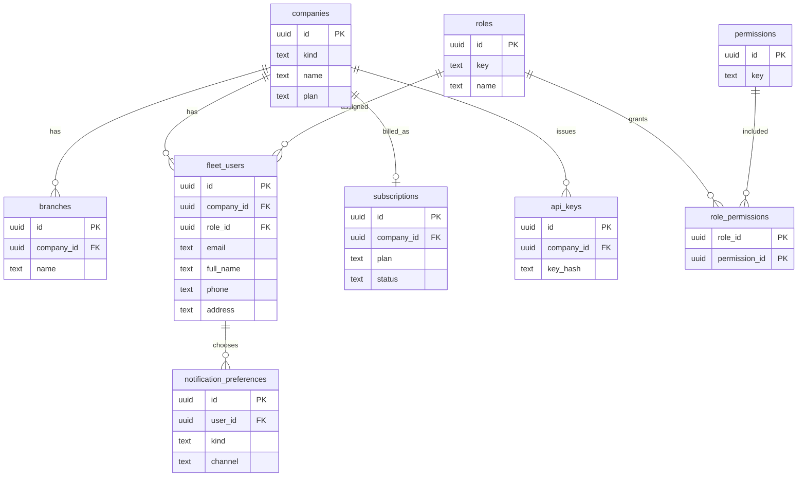

`email_otps` is not linked to a user. A signup code exists before the person does.

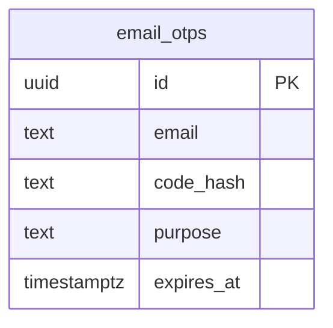

## 2. Trucks and drivers

`fleet_users.driver_id` is set only when that login is a driver. A third-party owner is a `vendors` row, and their truck has `ownership = attached`.

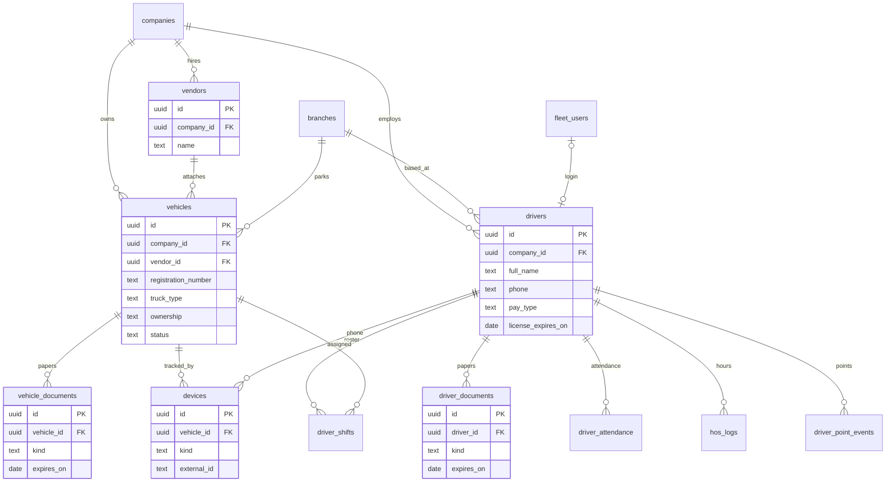

## 3. Orders and trips

One trip is one order, one truck, and one driver. Stops are the pickups and drops. Proof of delivery hangs off a stop, not the trip.

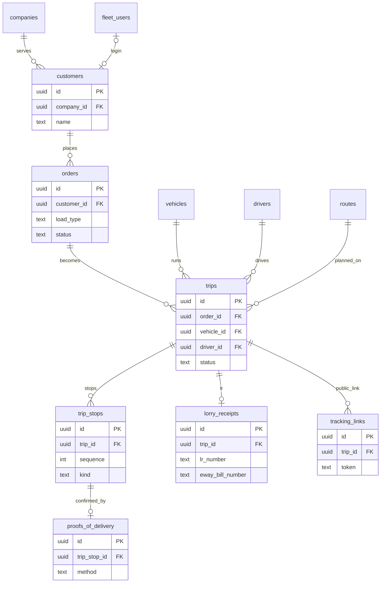

## 4. Live tracking

GPS points are the raw stream. A summary row is what remains after the raw points are deleted.

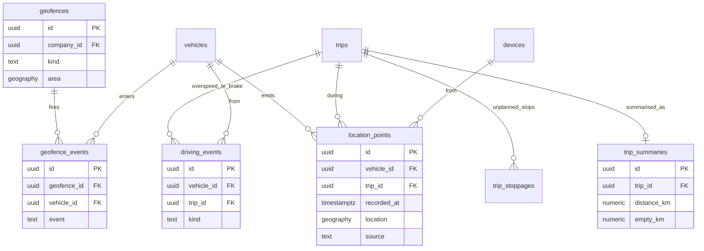

## 5. Maintenance

A work order is a repair on a truck. It is not a road repair.

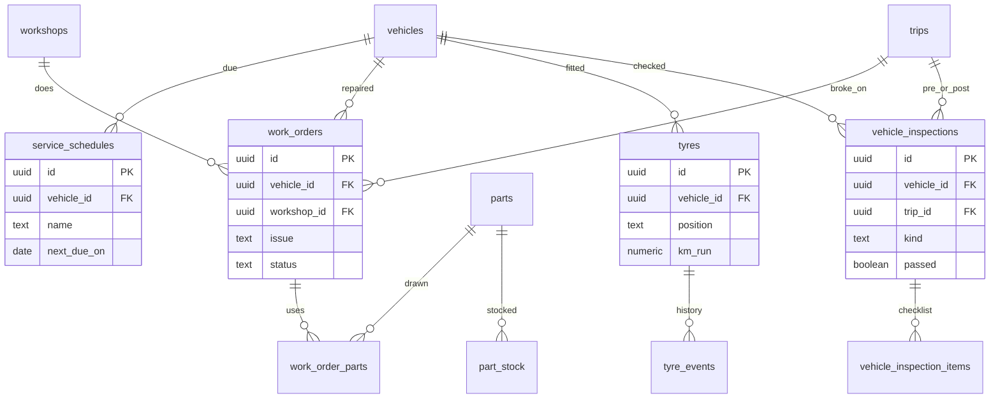

## 6. Fuel and money

The fleet's subscription (what they pay TransitIQ) is on `subscriptions` in diagram 1. The invoices here are bills the fleet sends to a shipper.

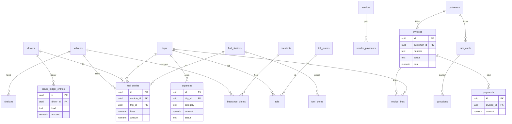

## 7. Roads, hazards, repair

These tables have no `company_id`, except a driver report, which records which fleet sent it. Many reports collapse into one incident. One repair ticket can close many incidents.

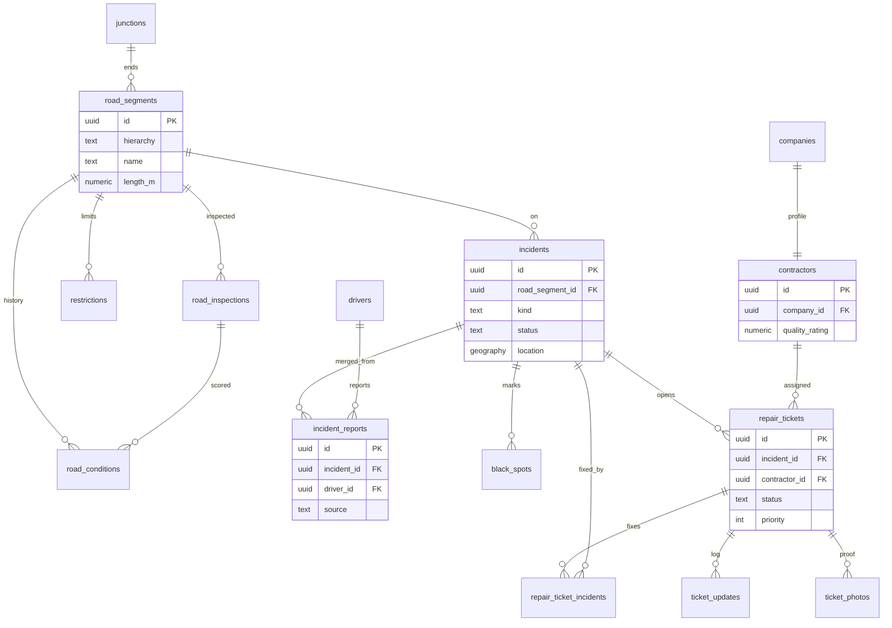

Toll plazas and checkpoints are places on the map. They are not owned by a fleet. Trip toll charges point at a plaza from diagram 6.

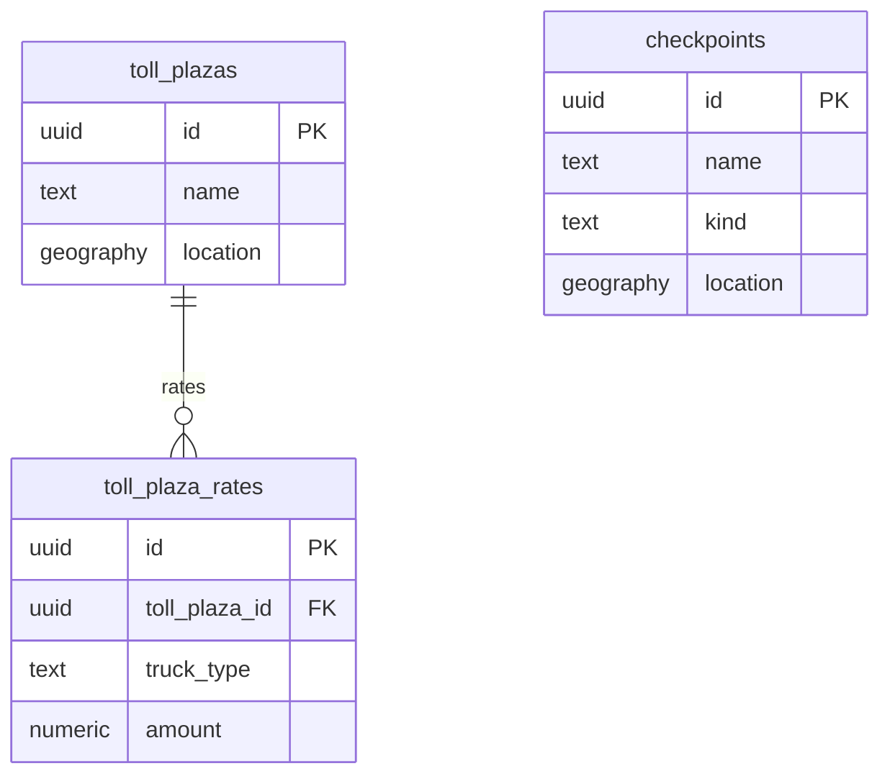

## 8. Alerts and shared files

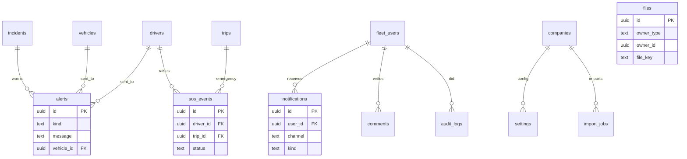

`files` has no foreign key. `owner_type` plus `owner_id` say which row the file belongs to.
