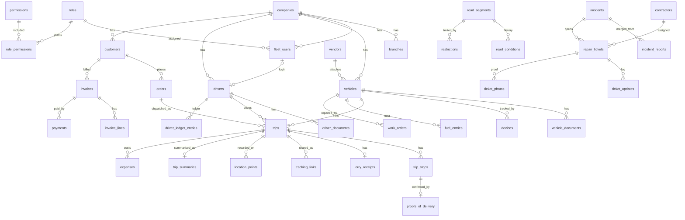

# TransitIQ database schema

Schema for everything the product stores, taken from `Docs/first.md` and the tables already in Postgres. This file is the table list, the columns, and how the tables connect. It is not a feature spec.

Live today, created on first sign-in or first visit to the owner dashboard by `lib/company/schema.ts`: `fleet_users`, `email_otps`, `companies`, `branches`, `roles`, `permissions`, `role_permissions`, and `vehicles`. The owner adds other people as more `fleet_users` rows in the same company. `password_hash` stays empty until that person sets a password. `vehicles.vendor_id` is reserved for attached trucks; the foreign key is added when the `vendors` table exists. Everything else below is still to be created.

## How to implement

Postgres, with two extensions:

```sql
CREATE EXTENSION IF NOT EXISTS pgcrypto; -- gen_random_uuid()
CREATE EXTENSION IF NOT EXISTS postgis;  -- map points, routes, geofences
```

Follow the same style as `lib/auth/schema.ts`: raw SQL, `CREATE TABLE IF NOT EXISTS`, run once per process. Add new groups in their own function (for example `ensureFleetSchema`) and call it from the routes that need those tables. Do not put file bytes in Postgres. Store the object-storage key in a `text` column.

Rules that apply to every table below:

- Primary key is `id uuid` default `gen_random_uuid()`.
- `created_at` and `updated_at` are `timestamptz`, default `now()`, not null.
- Business rows use soft delete: `deleted_at timestamptz` null. Queries add `deleted_at IS NULL`.
- A tenant table has `company_id uuid NOT NULL` referencing `companies(id)`. Every query filters on it. A missing filter leaks one fleet's data to another.
- Shared map data (roads, junctions, toll plazas, black spots) has no `company_id`. A fleet does not own the road.
- Status and type columns are `text` plus a `CHECK` constraint. Allowed values are listed in the Notes column.
- Money is `numeric(12,2)`. Quantities (litres, km, tonnes) are `numeric(12,3)`.
- A point is `geography(Point, 4326)`. A path is `geography(LineString, 4326)`. A zone is `geography(Polygon, 4326)`. Index those columns with GiST.
- Scores, profit, mileage, compliance, and utilisation are not tables. Compute them from the rows that record the facts. Cache a score on the parent row only when a screen needs the latest value.

Create tables in the order of the groups in this file. A table never references a table that has not been created yet.

Auth today signs a person in through `fleet_users`. Keep that table name so the current login code keeps working. In this schema it is the User entity. A driver, mechanic, or owner is a person row (`drivers`, and so on) plus an optional login (`fleet_users.driver_id`).

## Already in the database

### fleet_users

The login. This is the User entity. Add the columns in the second table with `ALTER TABLE`. Do not create a second users table.

| Column | Type | Required | Notes |
|---|---|---|---|
| id | uuid | yes | Primary key |
| email | text | yes | Unique |
| password_hash | text | no | Null until the person sets a password |
| created_at | timestamptz | yes | |
| updated_at | timestamptz | yes | |

Add:

| Column | Type | Required | Notes |
|---|---|---|---|
| company_id | uuid | no | Null only for a platform super admin. References `companies` |
| branch_id | uuid | no | References `branches` |
| role_id | uuid | no | References `roles` |
| driver_id | uuid | no | Set when this login is a driver |
| customer_id | uuid | no | Set when this login is a shipper |
| full_name | text | no | Owner's name. Collected when the fleet is set up |
| phone | text | no | Owner's phone. Driver sign-in later uses phone OTP |
| address | text | no | Owner's own address, separate from the company address |
| language | text | yes | `en` or `hi`. Default `en` |
| large_text | boolean | yes | Default false. Driver app accessibility |
| high_contrast | boolean | yes | Default false |
| two_factor_enabled | boolean | yes | Default false |
| deleted_at | timestamptz | no | |

### email_otps

One-time codes for signup and login. No foreign key to `fleet_users`, because a signup code exists before the user row.

| Column | Type | Required | Notes |
|---|---|---|---|
| id | uuid | yes | Primary key |
| email | text | yes | Indexed |
| code_hash | text | yes | Store the hash, never the code |
| expires_at | timestamptz | yes | Indexed |
| consumed_at | timestamptz | no | Null until the code is used |
| created_at | timestamptz | yes | |
| purpose | text | yes | Default `signup`. Also `login`, `set_password` |

## 1. Tenancy and access

The owner is not a separate table. The owner is a `fleet_users` row with the Owner role, inside one `companies` row. That company owns the vehicles, drivers, trips, and money.

### companies

One row per fleet, road authority, or contractor.

| Column | Type | Required | Notes |
|---|---|---|---|
| id | uuid | yes | |
| kind | text | yes | `fleet`, `authority`, `contractor` |
| name | text | yes | Display name |
| legal_name | text | no | Printed on invoices and lorry receipts |
| gstin | text | no | GST on customer invoices |
| phone | text | no | |
| email | text | no | |
| address | text | no | |
| logo_key | text | no | Object key. Used on the tracking page and invoices |
| invoice_template | text | no | Template key |
| plan | text | yes | `free` or `pro`. Default `free`. Free is capped at 3 vehicles |
| vehicle_limit | integer | yes | Default 3 |
| deleted_at | timestamptz | no | |

### branches

A fleet can have more than one branch. Vehicles, drivers, and users can point at a branch.

| Column | Type | Required | Notes |
|---|---|---|---|
| id | uuid | yes | |
| company_id | uuid | yes | |
| name | text | yes | |
| address | text | no | |
| deleted_at | timestamptz | no | |

### roles

Seed one row per role. These match the access table in the product doc.

| Column | Type | Required | Notes |
|---|---|---|---|
| id | uuid | yes | |
| key | text | yes | Unique. `super_admin`, `owner`, `fleet_manager`, `dispatcher`, `accountant`, `driver`, `mechanic`, `road_authority`, `contractor`, `customer` |
| name | text | yes | |

`super_admin` is the only role allowed to have `fleet_users.company_id` null.

### permissions

One row per action, for example `vehicles.write`, `invoices.read`, `trips.assign`.

| Column | Type | Required | Notes |
|---|---|---|---|
| id | uuid | yes | |
| key | text | yes | Unique |
| description | text | no | |

### role_permissions

| Column | Type | Required | Notes |
|---|---|---|---|
| role_id | uuid | yes | Primary key, part 1 |
| permission_id | uuid | yes | Primary key, part 2 |

### api_keys

Public API keys for a company. Store the hash only.

| Column | Type | Required | Notes |
|---|---|---|---|
| id | uuid | yes | |
| company_id | uuid | yes | |
| name | text | yes | |
| key_hash | text | yes | |
| last_used_at | timestamptz | no | |
| revoked_at | timestamptz | no | |

### notification_preferences

Which alerts a person wants, and on which channel.

| Column | Type | Required | Notes |
|---|---|---|---|
| id | uuid | yes | |
| user_id | uuid | yes | References `fleet_users` |
| kind | text | yes | `expiry`, `delay`, `hazard`, `repair`, `payment` |
| channel | text | yes | `push`, `email`, `sms`, `in_app` |
| enabled | boolean | yes | Default true |

Unique on `(user_id, kind, channel)`.

### subscriptions

What the fleet pays TransitIQ. Separate from invoices the fleet sends to its own customers.

| Column | Type | Required | Notes |
|---|---|---|---|
| id | uuid | yes | |
| company_id | uuid | yes | |
| plan | text | yes | `free`, `pro`, `authority` |
| status | text | yes | `trialing`, `active`, `past_due`, `canceled` |
| vehicle_limit | integer | yes | |
| provider | text | no | For example `razorpay` |
| provider_ref | text | no | |
| current_period_end | timestamptz | no | |

## 2. Fleet

### vehicles

| Column | Type | Required | Notes |
|---|---|---|---|
| id | uuid | yes | |
| company_id | uuid | yes | |
| branch_id | uuid | no | |
| vendor_id | uuid | no | Set when ownership is `attached`. Foreign key to `vendors` is added with that table |
| registration_number | text | yes | Unique per company |
| make | text | no | |
| model | text | no | |
| year | integer | no | |
| chassis_number | text | no | |
| engine_number | text | no | |
| truck_type | text | yes | `open`, `closed`, `trailer`, `tanker`, `container` |
| load_capacity_kg | numeric(12,3) | no | |
| axle_count | integer | no | |
| length_m | numeric(8,3) | no | Used by height, width, and weight restrictions |
| width_m | numeric(8,3) | no | |
| height_m | numeric(8,3) | no | |
| ownership | text | yes | `owned`, `leased`, `attached` |
| contract_start | date | no | Leased or attached |
| contract_end | date | no | |
| status | text | yes | `active`, `on_trip`, `idle`, `maintenance`, `retired` |
| odometer_km | numeric(12,3) | no | Last known reading |
| tank_capacity_l | numeric(8,3) | no | Fuel anomaly rule: fill above capacity |
| deleted_at | timestamptz | no | |

### vehicle_documents

RC, insurance, permit, fitness, pollution certificate, road tax. A trip must not be assigned when a required document is expired.

| Column | Type | Required | Notes |
|---|---|---|---|
| id | uuid | yes | |
| company_id | uuid | yes | |
| vehicle_id | uuid | yes | |
| kind | text | yes | `rc`, `insurance`, `permit`, `fitness`, `pollution`, `road_tax` |
| document_number | text | no | |
| file_key | text | no | Object key of the scan |
| issued_on | date | no | |
| expires_on | date | no | Reminders at 30, 15, and 7 days |
| deleted_at | timestamptz | no | |

### drivers

The person who drives. The login, if they have one, is `fleet_users.driver_id`.

| Column | Type | Required | Notes |
|---|---|---|---|
| id | uuid | yes | |
| company_id | uuid | yes | |
| branch_id | uuid | no | |
| full_name | text | yes | |
| phone | text | yes | |
| address | text | no | |
| photo_key | text | no | |
| emergency_name | text | no | SOS alerts this contact |
| emergency_phone | text | no | |
| license_number | text | no | |
| license_class | text | no | |
| license_expires_on | date | no | |
| license_endorsements | text | no | |
| pay_type | text | yes | `per_trip`, `per_km`, `salary`. Default `per_trip` |
| pay_rate | numeric(12,2) | no | Amount per trip, per km, or monthly salary |
| performance_score | numeric(5,2) | no | Cache. Computed from overspeed, harsh braking, idle, on-time |
| status | text | yes | `active`, `on_leave`, `inactive` |
| deleted_at | timestamptz | no | |

### driver_documents

License scan and any other driver paper. The license expiry used by the block rule lives on `drivers` as well, so assignment checks do not join this table.

| Column | Type | Required | Notes |
|---|---|---|---|
| id | uuid | yes | |
| company_id | uuid | yes | |
| driver_id | uuid | yes | |
| kind | text | yes | `license`, `other` |
| document_number | text | no | |
| file_key | text | no | |
| expires_on | date | no | |
| deleted_at | timestamptz | no | |

### devices

A truck is tracked by a GPS device or by the driver's phone.

| Column | Type | Required | Notes |
|---|---|---|---|
| id | uuid | yes | |
| company_id | uuid | yes | |
| vehicle_id | uuid | no | Phone trackers can be unbound until a trip starts |
| driver_id | uuid | no | |
| kind | text | yes | `gps` or `phone` |
| external_id | text | yes | Device id or phone installation id. Unique |
| last_seen_at | timestamptz | no | Offline alert when this goes stale |
| deleted_at | timestamptz | no | |

### driver_shifts

Who is assigned to which vehicle and shift.

| Column | Type | Required | Notes |
|---|---|---|---|
| id | uuid | yes | |
| company_id | uuid | yes | |
| driver_id | uuid | yes | |
| vehicle_id | uuid | no | |
| starts_at | timestamptz | yes | |
| ends_at | timestamptz | yes | |

### driver_attendance

| Column | Type | Required | Notes |
|---|---|---|---|
| id | uuid | yes | |
| company_id | uuid | yes | |
| driver_id | uuid | yes | |
| day | date | yes | |
| kind | text | yes | `present`, `absent`, `leave` |
| note | text | no | |

Unique on `(driver_id, day)`.

### hos_logs

Hours of service. Driving time and rest time, used to flag fatigue.

| Column | Type | Required | Notes |
|---|---|---|---|
| id | uuid | yes | |
| company_id | uuid | yes | |
| driver_id | uuid | yes | |
| trip_id | uuid | no | |
| kind | text | yes | `driving` or `rest` |
| started_at | timestamptz | yes | |
| ended_at | timestamptz | no | |

### driver_point_events

Safety programme. Points from verified hazard reports and clean driving. The leaderboard is a sum over a month, not its own table.

| Column | Type | Required | Notes |
|---|---|---|---|
| id | uuid | yes | |
| company_id | uuid | yes | |
| driver_id | uuid | yes | |
| points | integer | yes | |
| reason | text | yes | |
| source_type | text | no | `incident_report`, `trip` |
| source_id | uuid | no | |
| created_at | timestamptz | yes | |

## 3. Operations

### customers

The shipper. The company that owns the goods, not the fleet owner.

| Column | Type | Required | Notes |
|---|---|---|---|
| id | uuid | yes | |
| company_id | uuid | yes | The fleet this shipper belongs to |
| name | text | yes | |
| phone | text | no | |
| email | text | no | |
| gstin | text | no | Printed on their invoice |
| address | text | no | |
| deleted_at | timestamptz | no | |

### orders

A transport job before or apart from the truck assignment.

| Column | Type | Required | Notes |
|---|---|---|---|
| id | uuid | yes | |
| company_id | uuid | yes | |
| customer_id | uuid | yes | |
| load_type | text | no | |
| weight_kg | numeric(12,3) | no | |
| deadline_at | timestamptz | no | |
| notes | text | no | |
| status | text | yes | `open`, `assigned`, `completed`, `canceled` |
| deleted_at | timestamptz | no | |

### trips

One order, one vehicle, one driver. Status follows the lifecycle in the product doc.

| Column | Type | Required | Notes |
|---|---|---|---|
| id | uuid | yes | |
| company_id | uuid | yes | |
| order_id | uuid | no | |
| customer_id | uuid | no | Copied from the order so finance can group by customer |
| vehicle_id | uuid | no | Null until assigned |
| driver_id | uuid | no | Null until assigned |
| status | text | yes | `created`, `assigned`, `started`, `loading`, `in_transit`, `unloading`, `completed`, `closed` |
| planned_route | geography(LineString, 4326) | no | |
| route_reason | text | no | Why this route was chosen, for example a closure avoided |
| eta_at | timestamptz | no | Live ETA, updated on the way |
| started_at | timestamptz | no | |
| completed_at | timestamptz | no | |
| closed_at | timestamptz | no | |
| empty_run | boolean | yes | Default false. Return or empty kilometres |
| deleted_at | timestamptz | no | |

Assignment is refused when the vehicle or the driver has an expired document. That check is application logic, not a column.

### trip_stops

Pickup, drops, and the return. Several stops per trip. Arrival can be set by a geofence event.

| Column | Type | Required | Notes |
|---|---|---|---|
| id | uuid | yes | |
| company_id | uuid | yes | |
| trip_id | uuid | yes | |
| sequence | integer | yes | |
| kind | text | yes | `pickup`, `drop`, `return` |
| address | text | no | |
| location | geography(Point, 4326) | no | |
| scheduled_at | timestamptz | no | |
| arrived_at | timestamptz | no | |
| departed_at | timestamptz | no | |
| detention_minutes | integer | no | Waiting time at this stop |
| detention_charge | numeric(12,2) | no | |

### routes

A reusable path between two places, for rate cards and toll estimates. A trip copies the geometry onto `trips.planned_route`.

| Column | Type | Required | Notes |
|---|---|---|---|
| id | uuid | yes | |
| company_id | uuid | no | Null when the path is shared map data |
| name | text | yes | |
| path | geography(LineString, 4326) | yes | |
| distance_km | numeric(12,3) | no | |
| deleted_at | timestamptz | no | |

### proofs_of_delivery

| Column | Type | Required | Notes |
|---|---|---|---|
| id | uuid | yes | |
| company_id | uuid | yes | |
| trip_stop_id | uuid | yes | |
| method | text | yes | `signature`, `photo`, `otp` |
| file_key | text | no | Signature or photo |
| otp_hash | text | no | |
| confirmed_at | timestamptz | yes | |
| receiver_name | text | no | |

### lorry_receipts

Consignment note, plus the e-way bill stored on the same row.

| Column | Type | Required | Notes |
|---|---|---|---|
| id | uuid | yes | |
| company_id | uuid | yes | |
| trip_id | uuid | yes | Unique. One LR per trip |
| lr_number | text | yes | Unique per company |
| eway_bill_number | text | no | |
| eway_valid_until | timestamptz | no | Expiry alert |
| pdf_key | text | no | |
| issued_at | timestamptz | yes | |

### tracking_links

Public tracking URL for a shipment. No login.

| Column | Type | Required | Notes |
|---|---|---|---|
| id | uuid | yes | |
| company_id | uuid | yes | |
| trip_id | uuid | yes | |
| token | text | yes | Unique, unguessable |
| expires_at | timestamptz | no | |
| revoked_at | timestamptz | no | |

## 4. Tracking

### location_points

Raw GPS. Partition by month on `recorded_at`. Keep full detail for 90 days, then keep `trip_summaries` and throw the raw points away.

| Column | Type | Required | Notes |
|---|---|---|---|
| id | uuid | yes | |
| company_id | uuid | yes | |
| vehicle_id | uuid | yes | |
| trip_id | uuid | no | |
| driver_id | uuid | no | |
| device_id | uuid | no | |
| recorded_at | timestamptz | yes | Partition key |
| location | geography(Point, 4326) | yes | |
| speed_kmh | numeric(6,2) | no | |
| heading_deg | numeric(5,2) | no | |
| ignition_on | boolean | no | |
| idle | boolean | no | |
| source | text | yes | `gps` or `phone` |

Index `(vehicle_id, recorded_at)` and a GiST index on `location`.

### geofences

Depots, customer sites, restricted areas.

| Column | Type | Required | Notes |
|---|---|---|---|
| id | uuid | yes | |
| company_id | uuid | yes | |
| name | text | yes | |
| kind | text | yes | `depot`, `customer_site`, `restricted` |
| area | geography(Polygon, 4326) | yes | |
| customer_id | uuid | no | When the zone is a customer site |
| deleted_at | timestamptz | no | |

### geofence_events

Enter and exit. Also the source for "arrived" on a trip stop and for detention time.

| Column | Type | Required | Notes |
|---|---|---|---|
| id | uuid | yes | |
| company_id | uuid | yes | |
| geofence_id | uuid | yes | |
| vehicle_id | uuid | yes | |
| trip_id | uuid | no | |
| event | text | yes | `enter` or `exit` |
| recorded_at | timestamptz | yes | |

### trip_stoppages

A long or unplanned stop, flagged from the GPS stream.

| Column | Type | Required | Notes |
|---|---|---|---|
| id | uuid | yes | |
| company_id | uuid | yes | |
| trip_id | uuid | yes | |
| vehicle_id | uuid | yes | |
| location | geography(Point, 4326) | yes | |
| started_at | timestamptz | yes | |
| ended_at | timestamptz | no | |
| planned | boolean | yes | |

### trip_summaries

Kept after raw GPS is downsampled or deleted. Also the source for empty kilometres, idle time, and cost per km.

| Column | Type | Required | Notes |
|---|---|---|---|
| id | uuid | yes | |
| company_id | uuid | yes | |
| trip_id | uuid | yes | Unique |
| vehicle_id | uuid | yes | |
| driver_id | uuid | no | |
| distance_km | numeric(12,3) | yes | |
| empty_km | numeric(12,3) | yes | Default 0 |
| duration_min | integer | yes | |
| idle_min | integer | yes | Default 0 |
| fuel_litres | numeric(12,3) | no | |
| avg_speed_kmh | numeric(6,2) | no | |
| started_at | timestamptz | yes | |
| ended_at | timestamptz | yes | |

### driving_events

Overspeed, harsh braking. Plotted on the map and fed into the driver score. Not a replacement for `location_points`.

| Column | Type | Required | Notes |
|---|---|---|---|
| id | uuid | yes | |
| company_id | uuid | yes | |
| vehicle_id | uuid | yes | |
| driver_id | uuid | no | |
| trip_id | uuid | no | |
| kind | text | yes | `overspeed`, `harsh_brake` |
| location | geography(Point, 4326) | yes | |
| recorded_at | timestamptz | yes | |
| value | numeric(8,2) | no | Speed, or deceleration |
| road_segment_id | uuid | no | Filled when the point is matched to a road |

## 5. Maintenance

### workshops

Preferred mechanics.

| Column | Type | Required | Notes |
|---|---|---|---|
| id | uuid | yes | |
| company_id | uuid | yes | |
| name | text | yes | |
| phone | text | no | |
| address | text | no | |
| location | geography(Point, 4326) | no | Nearest-mechanic lookup on SOS |
| rating | numeric(3,2) | no | |
| deleted_at | timestamptz | no | |

### service_schedules

Reminder by kilometres, engine hours, or date.

| Column | Type | Required | Notes |
|---|---|---|---|
| id | uuid | yes | |
| company_id | uuid | yes | |
| vehicle_id | uuid | yes | |
| name | text | yes | Oil, brakes, filters, fluids |
| every_km | numeric(12,3) | no | |
| every_engine_hours | numeric(12,3) | no | |
| every_days | integer | no | |
| last_done_on | date | no | |
| last_odometer_km | numeric(12,3) | no | |
| next_due_on | date | no | |
| next_due_km | numeric(12,3) | no | |

### work_orders

A repair job, including a breakdown.

| Column | Type | Required | Notes |
|---|---|---|---|
| id | uuid | yes | |
| company_id | uuid | yes | |
| vehicle_id | uuid | yes | |
| workshop_id | uuid | no | |
| trip_id | uuid | no | |
| issue | text | yes | |
| location | geography(Point, 4326) | no | Where it broke down |
| status | text | yes | `open`, `assigned`, `in_progress`, `closed` |
| opened_at | timestamptz | yes | |
| closed_at | timestamptz | no | |
| downtime_min | integer | no | |
| labour_cost | numeric(12,2) | no | |
| parts_cost | numeric(12,2) | no | |
| deleted_at | timestamptz | no | |

### parts

| Column | Type | Required | Notes |
|---|---|---|---|
| id | uuid | yes | |
| company_id | uuid | yes | |
| name | text | yes | |
| sku | text | no | |
| reorder_below | numeric(12,3) | no | Alert when stock falls under this |
| deleted_at | timestamptz | no | |

### part_stock

| Column | Type | Required | Notes |
|---|---|---|---|
| id | uuid | yes | |
| company_id | uuid | yes | |
| part_id | uuid | yes | |
| branch_id | uuid | no | |
| quantity | numeric(12,3) | yes | |

### work_order_parts

| Column | Type | Required | Notes |
|---|---|---|---|
| id | uuid | yes | |
| work_order_id | uuid | yes | |
| part_id | uuid | yes | |
| quantity | numeric(12,3) | yes | |
| cost | numeric(12,2) | yes | |

### tyres

| Column | Type | Required | Notes |
|---|---|---|---|
| id | uuid | yes | |
| company_id | uuid | yes | |
| vehicle_id | uuid | no | Null when the tyre is off the truck |
| position | text | no | |
| brand | text | no | |
| fitted_on | date | no | |
| odometer_at_fit_km | numeric(12,3) | no | |
| km_run | numeric(12,3) | yes | Default 0 |
| retread_count | integer | yes | Default 0 |
| cost | numeric(12,2) | no | Cost per km is `cost / km_run` |
| deleted_at | timestamptz | no | |

### tyre_events

Fit, rotate, retread, remove.

| Column | Type | Required | Notes |
|---|---|---|---|
| id | uuid | yes | |
| company_id | uuid | yes | |
| tyre_id | uuid | yes | |
| vehicle_id | uuid | no | |
| kind | text | yes | `fit`, `rotate`, `retread`, `remove` |
| km_at_event | numeric(12,3) | no | |
| cost | numeric(12,2) | no | |
| recorded_at | timestamptz | yes | |

### vehicle_inspections

Pre-trip and post-trip checklist.

| Column | Type | Required | Notes |
|---|---|---|---|
| id | uuid | yes | |
| company_id | uuid | yes | |
| vehicle_id | uuid | yes | |
| trip_id | uuid | no | |
| driver_id | uuid | no | |
| kind | text | yes | `pre_trip` or `post_trip` |
| inspected_at | timestamptz | yes | |
| passed | boolean | yes | |

### vehicle_inspection_items

| Column | Type | Required | Notes |
|---|---|---|---|
| id | uuid | yes | |
| inspection_id | uuid | yes | |
| item | text | yes | Oil, brakes, lights |
| ok | boolean | yes | |
| photo_key | text | no | |
| note | text | no | |

## 6. Fuel and finance

### fuel_stations

| Column | Type | Required | Notes |
|---|---|---|---|
| id | uuid | yes | |
| company_id | uuid | no | Null if the station is shared reference data |
| name | text | yes | |
| location | geography(Point, 4326) | no | |

### fuel_prices

Price changes, so a route can prefer a cheaper station.

| Column | Type | Required | Notes |
|---|---|---|---|
| id | uuid | yes | |
| fuel_station_id | uuid | yes | |
| price_per_litre | numeric(8,2) | yes | |
| recorded_on | date | yes | |

### fuel_entries

| Column | Type | Required | Notes |
|---|---|---|---|
| id | uuid | yes | |
| company_id | uuid | yes | |
| vehicle_id | uuid | yes | |
| driver_id | uuid | no | |
| trip_id | uuid | no | |
| fuel_station_id | uuid | no | |
| filled_at | timestamptz | yes | |
| litres | numeric(12,3) | yes | |
| price_per_litre | numeric(8,2) | yes | |
| amount | numeric(12,2) | yes | |
| odometer_km | numeric(12,3) | no | |
| receipt_key | text | no | |
| anomaly | text | no | `drop_while_parked`, `low_mileage`, `over_capacity`. Null when the fill looks normal |

Kilometres per litre is computed from consecutive odometer readings and litres. It is not stored.

### expenses

Driver-submitted costs. A manager approves or rejects them. Trip costing sums the approved rows.

| Column | Type | Required | Notes |
|---|---|---|---|
| id | uuid | yes | |
| company_id | uuid | yes | |
| trip_id | uuid | no | |
| vehicle_id | uuid | no | |
| driver_id | uuid | no | |
| category | text | yes | `fuel`, `toll`, `food`, `repair`, `other`. Master list also lives in `settings` |
| amount | numeric(12,2) | yes | |
| status | text | yes | `pending`, `approved`, `rejected` |
| receipt_key | text | no | |
| note | text | no | |
| spent_at | timestamptz | yes | |
| decided_by | uuid | no | References `fleet_users` |
| decided_at | timestamptz | no | |

### tolls

A toll charge matched to a trip. FASTag imports land here.

| Column | Type | Required | Notes |
|---|---|---|---|
| id | uuid | yes | |
| company_id | uuid | yes | |
| trip_id | uuid | no | |
| vehicle_id | uuid | yes | |
| toll_plaza_id | uuid | no | |
| amount | numeric(12,2) | yes | |
| paid_at | timestamptz | yes | |
| source | text | yes | `fastag` or `manual` |
| external_ref | text | no | |

### driver_ledger_entries

Advances, expenses, deductions, and pay. Pending pay is the sum. Do not store a balance column.

| Column | Type | Required | Notes |
|---|---|---|---|
| id | uuid | yes | |
| company_id | uuid | yes | |
| driver_id | uuid | yes | |
| trip_id | uuid | no | |
| kind | text | yes | `advance`, `expense`, `deduction`, `pay` |
| amount | numeric(12,2) | yes | Positive number. `kind` says which way it moves |
| note | text | no | |
| recorded_at | timestamptz | yes | |

### invoices

Invoices the fleet sends to a shipper. GST is stored on the invoice because the printed bill must not change if tax rates change later.

| Column | Type | Required | Notes |
|---|---|---|---|
| id | uuid | yes | |
| company_id | uuid | yes | |
| customer_id | uuid | yes | |
| number | text | yes | Unique per company |
| status | text | yes | `pending`, `paid`, `overdue`, `canceled` |
| taxable_amount | numeric(12,2) | yes | |
| cgst | numeric(12,2) | yes | Default 0 |
| sgst | numeric(12,2) | yes | Default 0 |
| igst | numeric(12,2) | yes | Default 0 |
| total | numeric(12,2) | yes | |
| issued_on | date | yes | |
| due_on | date | no | |
| deleted_at | timestamptz | no | |

### invoice_lines

| Column | Type | Required | Notes |
|---|---|---|---|
| id | uuid | yes | |
| invoice_id | uuid | yes | |
| trip_id | uuid | no | |
| description | text | yes | |
| amount | numeric(12,2) | yes | |

### payments

Money received against an invoice.

| Column | Type | Required | Notes |
|---|---|---|---|
| id | uuid | yes | |
| company_id | uuid | yes | |
| invoice_id | uuid | yes | |
| amount | numeric(12,2) | yes | |
| method | text | no | |
| paid_at | timestamptz | yes | |
| reference | text | no | |

An invoice becomes `paid` when the sum of its payments covers `total`.

### challans

Traffic fines against a vehicle and a driver.

| Column | Type | Required | Notes |
|---|---|---|---|
| id | uuid | yes | |
| company_id | uuid | yes | |
| vehicle_id | uuid | yes | |
| driver_id | uuid | no | |
| reference | text | no | |
| amount | numeric(12,2) | yes | |
| status | text | yes | `pending` or `paid` |
| issued_on | date | yes | |
| paid_on | date | no | |

### vendors

Third-party truck owners whose vehicles are attached to this fleet. Not the fleet owner.

| Column | Type | Required | Notes |
|---|---|---|---|
| id | uuid | yes | |
| company_id | uuid | yes | The fleet |
| name | text | yes | |
| phone | text | no | |
| gstin | text | no | |
| deleted_at | timestamptz | no | |

### vendor_payments

| Column | Type | Required | Notes |
|---|---|---|---|
| id | uuid | yes | |
| company_id | uuid | yes | |
| vendor_id | uuid | yes | |
| trip_id | uuid | no | |
| kind | text | yes | `advance` or `payment` |
| amount | numeric(12,2) | yes | |
| paid_at | timestamptz | yes | |
| note | text | no | |

### rate_cards

| Column | Type | Required | Notes |
|---|---|---|---|
| id | uuid | yes | |
| company_id | uuid | yes | |
| customer_id | uuid | no | Null means the card applies to every customer |
| route_id | uuid | no | |
| truck_type | text | no | Same values as `vehicles.truck_type` |
| amount | numeric(12,2) | yes | |
| deleted_at | timestamptz | no | |

### quotations

| Column | Type | Required | Notes |
|---|---|---|---|
| id | uuid | yes | |
| company_id | uuid | yes | |
| customer_id | uuid | yes | |
| rate_card_id | uuid | no | |
| freight | numeric(12,2) | yes | |
| toll_estimate | numeric(12,2) | no | |
| fuel_estimate | numeric(12,2) | no | |
| status | text | yes | `draft`, `sent`, `accepted`, `rejected` |
| created_at | timestamptz | yes | |

### insurance_claims

| Column | Type | Required | Notes |
|---|---|---|---|
| id | uuid | yes | |
| company_id | uuid | yes | |
| vehicle_id | uuid | yes | |
| incident_id | uuid | no | |
| status | text | yes | `open`, `submitted`, `settled`, `rejected` |
| claimed_amount | numeric(12,2) | no | |
| settlement_amount | numeric(12,2) | no | |
| location | geography(Point, 4326) | no | |
| note | text | no | |
| opened_on | date | yes | |

Claim photos and papers are `files` rows with `owner_type = 'insurance_claim'`.

## 7. Road network

These tables are shared. They do not have `company_id`.

### junctions

| Column | Type | Required | Notes |
|---|---|---|---|
| id | uuid | yes | |
| name | text | no | |
| location | geography(Point, 4326) | yes | |

### road_segments

| Column | Type | Required | Notes |
|---|---|---|---|
| id | uuid | yes | |
| name | text | no | |
| hierarchy | text | yes | `highway`, `state`, `district`, `city` |
| start_junction_id | uuid | no | |
| end_junction_id | uuid | no | |
| path | geography(LineString, 4326) | yes | |
| length_m | numeric(12,3) | yes | |
| lanes | integer | no | |
| surface | text | no | |
| speed_limit_kmh | integer | no | |
| authority_name | text | no | |

### road_conditions

History of a segment. Each inspection appends a row. The latest row is the current score.

| Column | Type | Required | Notes |
|---|---|---|---|
| id | uuid | yes | |
| road_segment_id | uuid | yes | |
| score | text | yes | `good`, `fair`, `poor`, `critical` |
| potholes | boolean | yes | Default false |
| cracks | boolean | yes | Default false |
| edge_damage | boolean | yes | Default false |
| recorded_at | timestamptz | yes | |
| road_inspection_id | uuid | no | |

### road_inspections

Field inspection by an authority officer. This is not the driver's pre-trip inspection.

| Column | Type | Required | Notes |
|---|---|---|---|
| id | uuid | yes | |
| road_segment_id | uuid | yes | |
| inspector_user_id | uuid | no | References `fleet_users` |
| inspected_at | timestamptz | yes | |
| rating | text | yes | `good`, `fair`, `poor`, `critical` |
| note | text | no | |

Photos are `files` rows with `owner_type = 'road_inspection'`.

### restrictions

Height, weight, width, axle load, time bans, one-way, hazardous cargo.

| Column | Type | Required | Notes |
|---|---|---|---|
| id | uuid | yes | |
| road_segment_id | uuid | yes | |
| kind | text | yes | `height`, `weight`, `width`, `axle_load`, `time`, `one_way`, `no_entry`, `speed`, `hazardous_goods` |
| max_height_m | numeric(8,3) | no | |
| max_weight_t | numeric(8,3) | no | |
| max_width_m | numeric(8,3) | no | |
| max_axle_load_t | numeric(8,3) | no | |
| speed_limit_kmh | integer | no | |
| starts_at | time | no | Time-of-day rule |
| ends_at | time | no | |
| applies_to | text | no | Truck type, or `tanker` for hazardous goods. Null means every vehicle |
| note | text | no | |
| active | boolean | yes | Default true |

### toll_plazas

| Column | Type | Required | Notes |
|---|---|---|---|
| id | uuid | yes | |
| name | text | yes | |
| location | geography(Point, 4326) | yes | |
| opens_at | time | no | |
| closes_at | time | no | |

### toll_plaza_rates

Rate by vehicle class, so a route can estimate toll.

| Column | Type | Required | Notes |
|---|---|---|---|
| id | uuid | yes | |
| toll_plaza_id | uuid | yes | |
| truck_type | text | yes | Same values as `vehicles.truck_type` |
| amount | numeric(12,2) | yes | |

### checkpoints

Weigh stations, police posts, border posts.

| Column | Type | Required | Notes |
|---|---|---|---|
| id | uuid | yes | |
| name | text | yes | |
| kind | text | yes | `weigh_station`, `police`, `border` |
| location | geography(Point, 4326) | yes | |

## 8. Safety

### incidents

One real-world hazard. Many reports collapse into one incident when they fall inside a small radius.

| Column | Type | Required | Notes |
|---|---|---|---|
| id | uuid | yes | |
| road_segment_id | uuid | no | |
| kind | text | yes | `accident`, `breakdown`, `closure`, `diversion`, `waterlogging`, `landslide`, `fog`, `animal_crossing`, `pothole` |
| severity | text | yes | `low`, `medium`, `high` |
| status | text | yes | `reported`, `verified`, `in_progress`, `resolved` |
| location | geography(Point, 4326) | yes | |
| reported_at | timestamptz | yes | |
| verified_at | timestamptz | no | |
| resolved_at | timestamptz | no | |
| expires_at | timestamptz | no | Temporary hazards close themselves unless renewed |
| cause | text | no | Used for accident records |
| vehicles_involved | integer | no | |

Confirmed status is a rule: several independent `incident_reports`, or an authority user verifies it. The result is written to `status` and `verified_at`.

### incident_reports

A single submission from a driver, a citizen, or an officer. Created before it is merged into an incident, so `incident_id` starts null.

| Column | Type | Required | Notes |
|---|---|---|---|
| id | uuid | yes | |
| incident_id | uuid | no | |
| company_id | uuid | no | Set when a fleet driver reports. Null for a citizen |
| driver_id | uuid | no | |
| reporter_user_id | uuid | no | |
| source | text | yes | `driver`, `citizen`, `authority` |
| kind | text | yes | Same values as `incidents.kind` |
| location | geography(Point, 4326) | yes | |
| note | text | no | |
| photo_key | text | no | |
| reported_at | timestamptz | yes | |
| client_id | uuid | no | Unique. The phone generates this so an offline retry does not insert twice |

### black_spots

A stretch marked after N accidents inside a radius and a time window. The rule runs in a worker. This table stores the result.

| Column | Type | Required | Notes |
|---|---|---|---|
| id | uuid | yes | |
| road_segment_id | uuid | no | |
| location | geography(Point, 4326) | yes | |
| radius_m | integer | yes | |
| accident_count | integer | yes | |
| window_start | timestamptz | yes | |
| window_end | timestamptz | yes | |
| marked_at | timestamptz | yes | |
| active | boolean | yes | Default true |

### alerts

A warning sent to a driver, a vehicle, or every vehicle in an area.

| Column | Type | Required | Notes |
|---|---|---|---|
| id | uuid | yes | |
| company_id | uuid | no | Null for an authority broadcast |
| kind | text | yes | `hazard`, `closure`, `black_spot`, `restriction`, `overspeed`, `weather`, `broadcast` |
| message | text | yes | Short enough to read out as voice |
| reason | text | no | Why it fired |
| vehicle_id | uuid | no | |
| driver_id | uuid | no | |
| trip_id | uuid | no | |
| area | geography(Polygon, 4326) | no | Set for a broadcast |
| incident_id | uuid | no | |
| created_at | timestamptz | yes | |

### sos_events

| Column | Type | Required | Notes |
|---|---|---|---|
| id | uuid | yes | |
| company_id | uuid | yes | |
| driver_id | uuid | yes | |
| trip_id | uuid | no | |
| vehicle_id | uuid | no | |
| location | geography(Point, 4326) | yes | |
| raised_at | timestamptz | yes | |
| status | text | yes | `open`, `acknowledged`, `closed` |
| acknowledged_by | uuid | no | References `fleet_users` |

## 9. Repair

Road repair, raised for an authority. Distinct from a fleet `work_orders` row, which is a workshop job on a truck.

### contractors

A road contractor. The people who log in are `fleet_users` with the contractor role and `company_id` pointing at a `companies` row of kind `contractor`. This table is the work profile.

| Column | Type | Required | Notes |
|---|---|---|---|
| id | uuid | yes | |
| company_id | uuid | yes | Unique. The contractor organisation |
| quality_rating | numeric(3,2) | no | Updated from verified tickets |
| deleted_at | timestamptz | no | |

### repair_tickets

| Column | Type | Required | Notes |
|---|---|---|---|
| id | uuid | yes | |
| incident_id | uuid | no | |
| road_inspection_id | uuid | no | |
| road_segment_id | uuid | no | |
| contractor_id | uuid | no | |
| status | text | yes | `open`, `assigned`, `in_progress`, `completed`, `verified` |
| severity | text | yes | `low`, `medium`, `high` |
| priority | integer | yes | Higher is more urgent. Rule uses severity, traffic, and accident history |
| deadline_at | timestamptz | no | |
| cost | numeric(12,2) | no | |
| opened_at | timestamptz | yes | |
| completed_at | timestamptz | no | |
| verified_at | timestamptz | no | |

One ticket can fix many incidents. That link is `repair_ticket_incidents`, because `incident_id` on the ticket only records the incident that opened it.

### repair_ticket_incidents

| Column | Type | Required | Notes |
|---|---|---|---|
| repair_ticket_id | uuid | yes | Primary key, part 1 |
| incident_id | uuid | yes | Primary key, part 2 |

### ticket_updates

| Column | Type | Required | Notes |
|---|---|---|---|
| id | uuid | yes | |
| repair_ticket_id | uuid | yes | |
| author_user_id | uuid | no | |
| status | text | no | Status after this update |
| note | text | no | |
| created_at | timestamptz | yes | |

### ticket_photos

Before and after proof.

| Column | Type | Required | Notes |
|---|---|---|---|
| id | uuid | yes | |
| repair_ticket_id | uuid | yes | |
| kind | text | yes | `before` or `after` |
| file_key | text | yes | |
| taken_at | timestamptz | yes | |

## 10. System

### files

Every other photo or paper that does not already have its own `file_key` column: claim documents, citizen photos beyond the first, comment attachments.

| Column | Type | Required | Notes |
|---|---|---|---|
| id | uuid | yes | |
| company_id | uuid | no | |
| owner_type | text | yes | `insurance_claim`, `road_inspection`, `incident_report`, `comment` |
| owner_id | uuid | yes | |
| file_key | text | yes | |
| kind | text | no | `photo`, `document` |
| created_at | timestamptz | yes | |

### comments

Notes on a trip or a ticket.

| Column | Type | Required | Notes |
|---|---|---|---|
| id | uuid | yes | |
| company_id | uuid | no | |
| author_user_id | uuid | yes | |
| target_type | text | yes | `trip`, `repair_ticket`, `work_order` |
| target_id | uuid | yes | |
| body | text | yes | |
| created_at | timestamptz | yes | |

### notifications

A message already sent or waiting to send.

| Column | Type | Required | Notes |
|---|---|---|---|
| id | uuid | yes | |
| company_id | uuid | no | |
| user_id | uuid | yes | References `fleet_users` |
| channel | text | yes | `push`, `email`, `sms`, `in_app` |
| kind | text | yes | |
| title | text | yes | |
| body | text | yes | |
| sent_at | timestamptz | no | |
| read_at | timestamptz | no | |
| created_at | timestamptz | yes | |

### audit_logs

Who changed what. Append only. No `updated_at`, no soft delete.

| Column | Type | Required | Notes |
|---|---|---|---|
| id | uuid | yes | |
| company_id | uuid | no | |
| user_id | uuid | no | |
| action | text | yes | `insert`, `update`, `delete` |
| table_name | text | yes | |
| record_id | uuid | yes | |
| diff | jsonb | no | |
| created_at | timestamptz | yes | |

### settings

Thresholds and master lists for one company. Speed limit, idle minutes, black-spot rule inputs, expense categories, incident types.

| Column | Type | Required | Notes |
|---|---|---|---|
| id | uuid | yes | |
| company_id | uuid | yes | |
| key | text | yes | |
| value | jsonb | yes | |

Unique on `(company_id, key)`.

### import_jobs

CSV or Excel import of vehicles, drivers, or past trips.

| Column | Type | Required | Notes |
|---|---|---|---|
| id | uuid | yes | |
| company_id | uuid | yes | |
| user_id | uuid | yes | |
| kind | text | yes | `vehicles`, `drivers`, `trips` |
| status | text | yes | `pending`, `running`, `done`, `failed` |
| file_key | text | yes | |
| error | text | no | |
| created_at | timestamptz | yes | |
| finished_at | timestamptz | no | |

## Relationships



Foreign keys in table form:

| From | Column | To |
|---|---|---|
| branches | company_id | companies |
| fleet_users | company_id | companies |
| fleet_users | branch_id | branches |
| fleet_users | role_id | roles |
| fleet_users | driver_id | drivers |
| fleet_users | customer_id | customers |
| role_permissions | role_id, permission_id | roles, permissions |
| api_keys | company_id | companies |
| notification_preferences | user_id | fleet_users |
| subscriptions | company_id | companies |
| vehicles | company_id, branch_id, vendor_id | companies, branches, vendors |
| vehicle_documents | vehicle_id | vehicles |
| drivers | company_id, branch_id | companies, branches |
| driver_documents | driver_id | drivers |
| devices | vehicle_id, driver_id | vehicles, drivers |
| driver_shifts | driver_id, vehicle_id | drivers, vehicles |
| driver_attendance | driver_id | drivers |
| hos_logs | driver_id, trip_id | drivers, trips |
| driver_point_events | driver_id | drivers |
| customers | company_id | companies |
| orders | customer_id | customers |
| trips | order_id, customer_id, vehicle_id, driver_id | orders, customers, vehicles, drivers |
| trip_stops | trip_id | trips |
| proofs_of_delivery | trip_stop_id | trip_stops |
| lorry_receipts | trip_id | trips |
| tracking_links | trip_id | trips |
| location_points | vehicle_id, trip_id, driver_id, device_id | vehicles, trips, drivers, devices |
| geofences | company_id, customer_id | companies, customers |
| geofence_events | geofence_id, vehicle_id, trip_id | geofences, vehicles, trips |
| trip_stoppages | trip_id, vehicle_id | trips, vehicles |
| trip_summaries | trip_id, vehicle_id, driver_id | trips, vehicles, drivers |
| driving_events | vehicle_id, driver_id, trip_id, road_segment_id | vehicles, drivers, trips, road_segments |
| workshops | company_id | companies |
| service_schedules | vehicle_id | vehicles |
| work_orders | vehicle_id, workshop_id, trip_id | vehicles, workshops, trips |
| parts | company_id | companies |
| part_stock | part_id, branch_id | parts, branches |
| work_order_parts | work_order_id, part_id | work_orders, parts |
| tyres | vehicle_id | vehicles |
| tyre_events | tyre_id, vehicle_id | tyres, vehicles |
| vehicle_inspections | vehicle_id, trip_id, driver_id | vehicles, trips, drivers |
| vehicle_inspection_items | inspection_id | vehicle_inspections |
| fuel_prices | fuel_station_id | fuel_stations |
| fuel_entries | vehicle_id, driver_id, trip_id, fuel_station_id | vehicles, drivers, trips, fuel_stations |
| expenses | trip_id, vehicle_id, driver_id, decided_by | trips, vehicles, drivers, fleet_users |
| tolls | trip_id, vehicle_id, toll_plaza_id | trips, vehicles, toll_plazas |
| driver_ledger_entries | driver_id, trip_id | drivers, trips |
| invoices | customer_id | customers |
| invoice_lines | invoice_id, trip_id | invoices, trips |
| payments | invoice_id | invoices |
| challans | vehicle_id, driver_id | vehicles, drivers |
| vendors | company_id | companies |
| vendor_payments | vendor_id, trip_id | vendors, trips |
| rate_cards | customer_id, route_id | customers, routes |
| quotations | customer_id, rate_card_id | customers, rate_cards |
| insurance_claims | vehicle_id, incident_id | vehicles, incidents |
| road_segments | start_junction_id, end_junction_id | junctions |
| road_conditions | road_segment_id, road_inspection_id | road_segments, road_inspections |
| road_inspections | road_segment_id | road_segments |
| restrictions | road_segment_id | road_segments |
| toll_plaza_rates | toll_plaza_id | toll_plazas |
| incident_reports | incident_id, driver_id | incidents, drivers |
| incidents | road_segment_id | road_segments |
| black_spots | road_segment_id | road_segments |
| alerts | vehicle_id, driver_id, trip_id, incident_id | vehicles, drivers, trips, incidents |
| sos_events | driver_id, trip_id, vehicle_id | drivers, trips, vehicles |
| contractors | company_id | companies |
| repair_tickets | incident_id, road_inspection_id, road_segment_id, contractor_id | incidents, road_inspections, road_segments, contractors |
| repair_ticket_incidents | repair_ticket_id, incident_id | repair_tickets, incidents |
| ticket_updates | repair_ticket_id | repair_tickets |
| ticket_photos | repair_ticket_id | repair_tickets |
| comments | author_user_id | fleet_users |
| notifications | user_id | fleet_users |
| audit_logs | user_id | fleet_users |
| settings | company_id | companies |
| import_jobs | company_id, user_id | companies, fleet_users |

`files.target` is polymorphic (`owner_type`, `owner_id`), so it has no foreign key.

## What is not a table

| Need | Where it comes from |
|---|---|
| Profit per truck, route, driver, customer | invoices, payments, fuel_entries, tolls, expenses, driver_ledger_entries, work_orders |
| Kilometres per litre | fuel_entries.odometer_km and litres |
| Compliance dashboard | vehicle_documents.expires_on and drivers.license_expires_on |
| Utilisation and idle days | trip_summaries and vehicles.status |
| Driver score | driving_events, trip on-time (completed_at against orders.deadline_at), driver_point_events |
| Black-spot rule | count of accident incidents, then insert black_spots |
| Expiry reminders | documents plus notifications. The 30, 15, and 7 day marks are a worker, not rows |
| Export of all data | read API over the tenant tables. No export table |

## Create order

Build in this order. Each step only needs tables from earlier steps.

1. Extensions, then `companies`, `branches`, `roles`, `permissions`, `role_permissions`. Seed the ten roles.
2. Alter `fleet_users`. Add `notification_preferences`, `subscriptions`, `api_keys`.
3. `vendors`, `vehicles`, `vehicle_documents`, `drivers`, `driver_documents`, `devices`.
4. `customers`, `orders`, `routes`, `trips`, `trip_stops`, `proofs_of_delivery`, `lorry_receipts`, `tracking_links`.
5. `location_points` (partitioned), `geofences`, `geofence_events`, `trip_stoppages`, `trip_summaries`, `driving_events`.
6. Maintenance, then fuel and finance, then the road tables, then safety and repair, then system tables.

Step 1 is the fleet-owner model: a company, and a user on that company with the owner role. Vehicles and drivers come after that, because both require `company_id`.

## Step 1 SQL

This matches the style of `lib/auth/schema.ts`. Later tables use the same column types as the catalogs above.

```sql
CREATE EXTENSION IF NOT EXISTS pgcrypto;
CREATE EXTENSION IF NOT EXISTS postgis;

CREATE TABLE IF NOT EXISTS companies (
  id uuid PRIMARY KEY DEFAULT gen_random_uuid(),
  kind text NOT NULL CHECK (kind IN ('fleet', 'authority', 'contractor')),
  name text NOT NULL,
  legal_name text,
  gstin text,
  phone text,
  email text,
  address text,
  logo_key text,
  invoice_template text,
  plan text NOT NULL DEFAULT 'free' CHECK (plan IN ('free', 'pro')),
  vehicle_limit integer NOT NULL DEFAULT 3,
  created_at timestamptz NOT NULL DEFAULT now(),
  updated_at timestamptz NOT NULL DEFAULT now(),
  deleted_at timestamptz
);

CREATE TABLE IF NOT EXISTS branches (
  id uuid PRIMARY KEY DEFAULT gen_random_uuid(),
  company_id uuid NOT NULL REFERENCES companies(id),
  name text NOT NULL,
  address text,
  created_at timestamptz NOT NULL DEFAULT now(),
  updated_at timestamptz NOT NULL DEFAULT now(),
  deleted_at timestamptz
);

CREATE TABLE IF NOT EXISTS roles (
  id uuid PRIMARY KEY DEFAULT gen_random_uuid(),
  key text NOT NULL UNIQUE,
  name text NOT NULL
);

CREATE TABLE IF NOT EXISTS permissions (
  id uuid PRIMARY KEY DEFAULT gen_random_uuid(),
  key text NOT NULL UNIQUE,
  description text
);

CREATE TABLE IF NOT EXISTS role_permissions (
  role_id uuid NOT NULL REFERENCES roles(id),
  permission_id uuid NOT NULL REFERENCES permissions(id),
  PRIMARY KEY (role_id, permission_id)
);

INSERT INTO roles (key, name) VALUES
  ('super_admin', 'Super Admin'),
  ('owner', 'Owner'),
  ('fleet_manager', 'Fleet Manager'),
  ('dispatcher', 'Dispatcher'),
  ('accountant', 'Accountant'),
  ('driver', 'Driver'),
  ('mechanic', 'Mechanic'),
  ('road_authority', 'Road Authority'),
  ('contractor', 'Contractor'),
  ('customer', 'Customer')
ON CONFLICT (key) DO NOTHING;

ALTER TABLE fleet_users
  ADD COLUMN IF NOT EXISTS company_id uuid REFERENCES companies(id),
  ADD COLUMN IF NOT EXISTS branch_id uuid REFERENCES branches(id),
  ADD COLUMN IF NOT EXISTS role_id uuid REFERENCES roles(id),
  ADD COLUMN IF NOT EXISTS full_name text,
  ADD COLUMN IF NOT EXISTS phone text,
  ADD COLUMN IF NOT EXISTS language text NOT NULL DEFAULT 'en',
  ADD COLUMN IF NOT EXISTS large_text boolean NOT NULL DEFAULT false,
  ADD COLUMN IF NOT EXISTS high_contrast boolean NOT NULL DEFAULT false,
  ADD COLUMN IF NOT EXISTS two_factor_enabled boolean NOT NULL DEFAULT false,
  ADD COLUMN IF NOT EXISTS deleted_at timestamptz;

-- driver_id and customer_id are added after those tables exist:
-- ALTER TABLE fleet_users ADD COLUMN IF NOT EXISTS driver_id uuid REFERENCES drivers(id);
-- ALTER TABLE fleet_users ADD COLUMN IF NOT EXISTS customer_id uuid REFERENCES customers(id);
```

`language` needs a check once the column exists:

```sql
ALTER TABLE fleet_users
  DROP CONSTRAINT IF EXISTS fleet_users_language_check;
ALTER TABLE fleet_users
  ADD CONSTRAINT fleet_users_language_check CHECK (language IN ('en', 'hi'));
```
